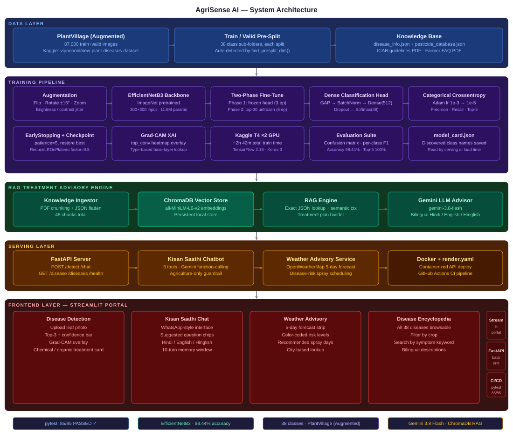
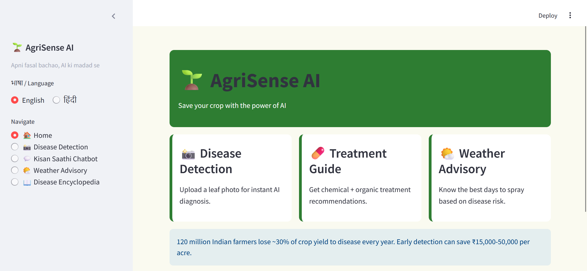
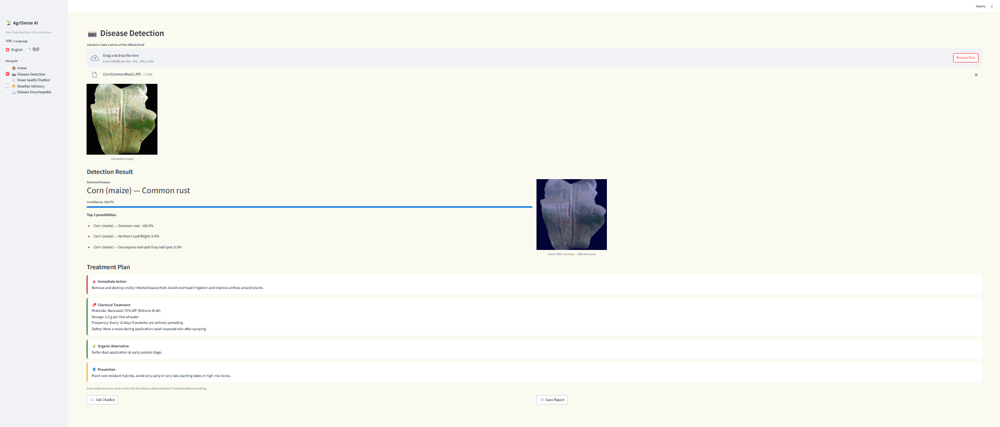
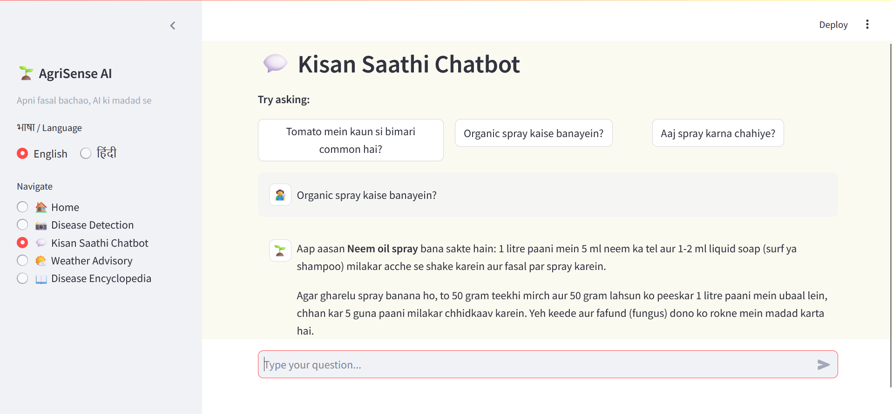
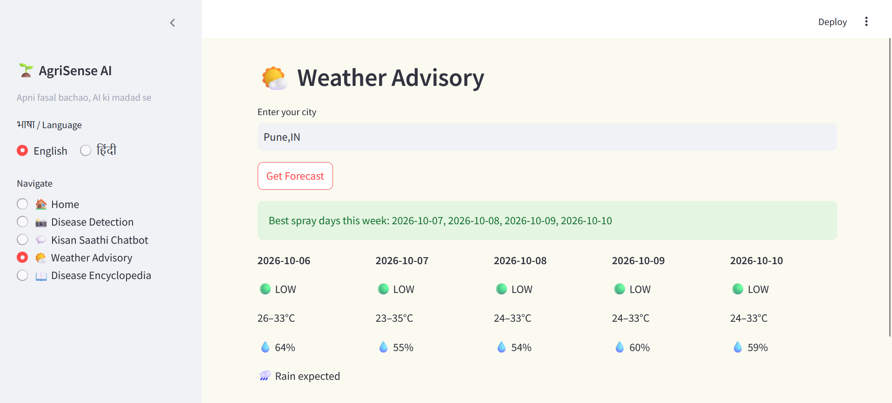
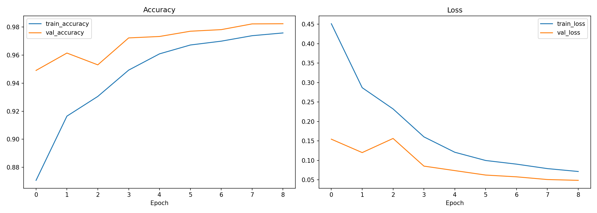
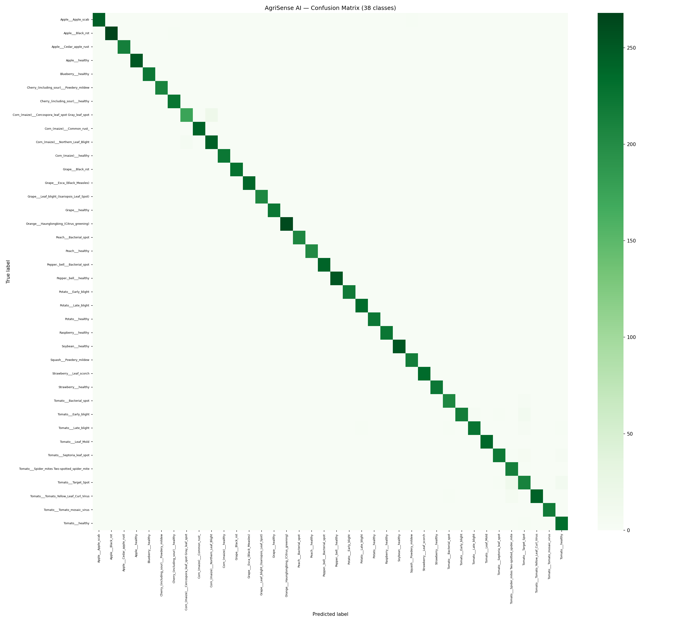
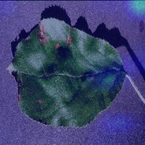
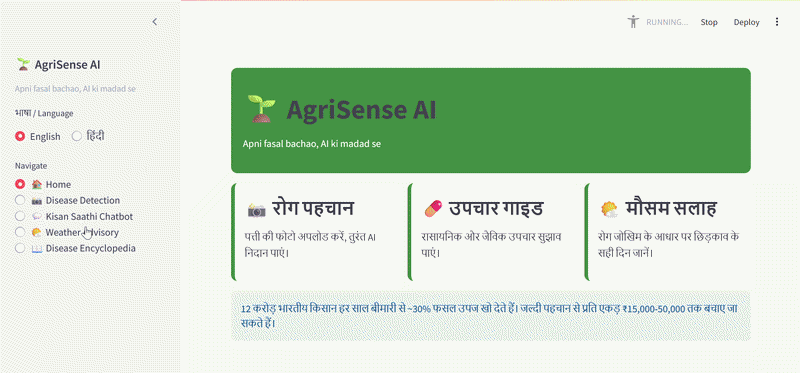
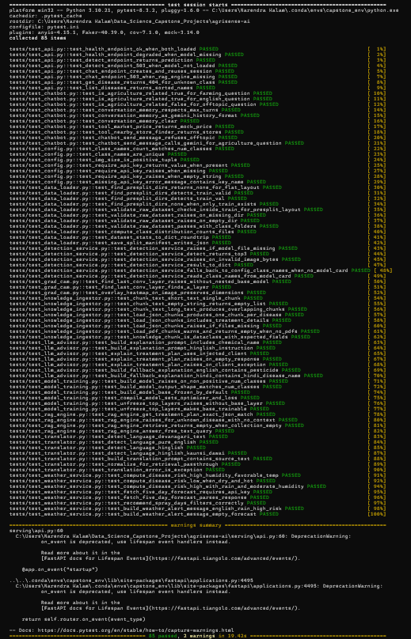

# 🌱 AgriSense AI — Crop Disease Detection + Hindi/English Treatment Advisory

[](https://github.com/narendrakalam2001/agrisense-ai/actions/workflows/ci.yml)
[](https://python.org)
[](https://tensorflow.org)
[](https://keras.io)
[](https://arxiv.org/abs/1905.11946)
[](#-model-results)
[](https://fastapi.tiangolo.com)
[](https://streamlit.io)
[](https://www.trychroma.com)
[](https://ai.google.dev)
[](https://docker.com)
[](#-test-coverage)
[](LICENSE)

> **Domain:** AgriTech / Computer Vision + RAG + Conversational AI  
> **Problem:** Multi-class leaf-image classification (38 classes: 26 diseases + 12 healthy) with a bilingual treatment plan and a farmer chatbot  
> **Dataset:** [New Plant Diseases Dataset (Augmented) — 87,867 images · 38 classes · 14 crops](https://www.kaggle.com/datasets/vipoooool/new-plant-diseases-dataset) (augmented version of [PlantVillage](https://www.kaggle.com/datasets/emmarex/plantdisease))  
> **Target stakeholders:** Mahindra AgriTech · Bayer Crop Science India · UPL Limited · State Agriculture Departments — aligned with the Digital Agriculture Mission

---

## 💡 Why This Project Matters

Crop disease is caught late because the people who can diagnose it are far away. The project brief this system was built against cites roughly **30 % of Indian crop yield lost to disease (≈ ₹90,000 crore a year)** and about **one agriculture extension officer per 1,000 farmers**. Existing diagnosis apps are mostly English-only. AgriSense AI is a working end-to-end prototype of the alternative:

- A **leaf photo** goes in; an **EfficientNetB3** classifier returns the disease, a confidence score, the top-3 candidates and a **Grad-CAM heatmap** showing which part of the leaf drove the decision
- A **RAG treatment engine** (ChromaDB + curated JSON knowledge base) returns a structured plan — *immediate action · chemical treatment (dose, frequency, safety) · organic alternative · prevention · expected recovery* — in **Hindi or English**
- **Kisan Saathi**, a Gemini-powered chatbot with 5 tools, answers follow-up questions in **Hindi, English or Hinglish** and refuses non-farming topics
- A **weather module** turns a 5-day OpenWeatherMap forecast into a daily fungal-risk rating and recommended spray days
- Everything is served two ways: a **Streamlit farmer portal** and a **FastAPI backend** (for mobile apps, WhatsApp bots or partner systems)

> ⚠️ **This is an advisory prototype.** The treatment knowledge base is starter content compiled for this project — not a reproduction of ICAR publications — and must be validated by an agronomist / Krishi Vigyan Kendra before any real-world use. See [Ethical Considerations & Limitations](#-ethical-considerations--limitations).

---

## 🏆 Model Results

Single architecture, trained once on Kaggle (T4 ×2). Metrics are on the held-out test half of the dataset's `valid/` split.

| Metric | Result | Target |
|---|---|---|
| **Test accuracy** | **98.44 %** | ≥ 92 % ✅ |
| **Top-5 accuracy** | **100.00 %** | — |
| **Macro F1** | **0.9843** | — |
| **Weakest class F1** | **0.8847** | ≥ 0.85 ✅ |
| Mean inference latency | 0.112 s / image (measured on Kaggle T4 GPU) | ≤ 2 s on CPU — *CPU latency not yet benchmarked* |
| Model size | 12.01 MB (TFLite) | mobile-friendly |
| Training time | ≈ 2 h 39 min fit time (≈ 2 h 48 min full pipeline) | — |

**Training configuration:** EfficientNetB3 (ImageNet weights, 300×300 input, 11.6 M parameters) → GlobalAveragePooling → BatchNorm → Dense(512) → Dropout → Softmax(38). Two phases: **Phase 1** trains the new head with the base frozen (3 epochs, lr 1e-3); **Phase 2** unfreezes the top 30 base layers — BatchNorm kept frozen, leaving 23 trainable layers — and fine-tunes (6 epochs, lr 1e-5). Best epoch is restored by `EarlyStopping(restore_best_weights=True)`.

### All epochs (nothing hidden)

| Phase | Epoch | Train acc | Val acc | Val loss | |
|---|---|---|---|---|---|
| 1 | 1 | 0.8707 | 0.9491 | 0.1545 | |
| 1 | 2 | 0.9165 | 0.9615 | 0.1201 | ⭐ best of phase 1 |
| 1 | 3 | 0.9305 | 0.9531 | 0.1564 | |
| 2 | 1 | 0.9493 | 0.9723 | 0.0853 | |
| 2 | 2 | 0.9609 | 0.9733 | 0.0738 | |
| 2 | 3 | 0.9672 | 0.9770 | 0.0623 | |
| 2 | 4 | 0.9700 | 0.9782 | 0.0578 | |
| 2 | 5 | 0.9739 | 0.9823 | 0.0508 | |
| 2 | 6 | 0.9758 | 0.9824 | 0.0487 | ⭐ **final model** |

Per-class precision / recall / F1 for **all 38 classes** (including the weakest) are stored in [`models/model_card.json`](models/model_card.json); the confusion matrix is in [`docs/plots/confusion_matrix.png`](docs/plots/confusion_matrix.png).

> **Model selection note:** one architecture (EfficientNetB3, as specified in the project brief) was trained; "best" above means the best *epoch*, not the best of several models. A challenger comparison (e.g. MobileNetV2 / EfficientNetB0) is on the [roadmap](#-roadmap).

---

## 🔗 Live Links

| Service | URL |
|---|---|
| 🚀 **FastAPI (Swagger UI)** | `http://localhost:8000/docs` when running locally · 🚧 *Render deployment pending — add URL here* |
| 🌾 **Farmer Portal (Streamlit)** | `http://localhost:8501` when running locally · 🚧 *Streamlit Cloud deployment pending — add URL here* |
| 📓 **EDA & Training Notebook** | [notebooks/agrisense_ai_eda.ipynb](notebooks/agrisense_ai_eda.ipynb) |
| 🧠 **Model Card** | [models/model_card.json](models/model_card.json) |

---

## 🏗️ System Architecture

<p align="center">
  
</p>

```
╔════════════════════════════════════════════════════════════════════════════════════════╗
║   AGRISENSE AI — 5-LAYER PRODUCTION SYSTEM                                             ║
╠════════════════════════════════════════════════════════════════════════════════════════╣
║                                                                                        ║
║  ┌─────────────────────────────────── DATA LAYER ───────────────────────────────────┐  ║
║  │ New Plant Diseases Dataset (Augmented) → train/ + valid/ → 38 class folders      │  ║
║  │ 70,295 train · 17,572 valid images · valid split ~50/50 → validation + test      │  ║
║  │ Knowledge base: disease_info.json · pesticide_database.json · ICAR + FAQ PDFs    │  ║
║  └─────────────────────────────────────────┬────────────────────────────────────────┘  ║
║                                            ▼                                           ║
║  ┌─────────────────────────────── TRAINING PIPELINE ────────────────────────────────┐  ║
║  │                                                                                  │  ║
║  │ ┌────────────────────┐   ┌────────────────────────┐   ┌────────────────────────┐ │  ║
║  │ │ Augmentation       │   │ EfficientNetB3         │   │ Evaluation             │ │  ║
║  │ │ Flip · Rotate ±15° │   │ ImageNet pretrained    │   │ Accuracy · F1 · Top-5  │ │  ║
║  │ │ Zoom · Brightness  │ ─▶│ P1: head only (3 ep)   │ ─▶│ Confusion matrix      │ │  ║
║  │ │ Contrast · Crop    │   │ P2: top-30 tuned (6)   │   │ Grad-CAM · model card  │ │  ║
║  │ └────────────────────┘   └────────────────────────┘   └────────────────────────┘ │  ║
║  │                                                                                  │  ║
║  │ Categorical crossentropy · Adam 1e-3 → 1e-5 · EarlyStopping · ReduceLROnPlateau  │  ║
║  │ Trained on Kaggle T4 ×2 GPU · TensorFlow 2.16 · Keras 3                          │  ║
║  │                                                                                  │  ║
║  │ RESULT → EfficientNetB3  Test acc=98.44%  Top-5=100%  Macro-F1=0.9843            │  ║
║  └─────────────────────────────────────────┬────────────────────────────────────────┘  ║
║                                            ▼                                           ║
║  ┌───────────────────────── RAG TREATMENT ADVISORY ENGINE ──────────────────────────┐  ║
║  │ Knowledge Ingestor → ChromaDB (all-MiniLM-L6-v2 · 48 chunks) → RAG Engine        │  ║
║  │ Exact JSON lookup (no hallucination) + semantic context for follow-up questions  │  ║
║  │ Gemini LLM Advisor (gemini-3.8-flash) → Hindi / English / Hinglish explanation   │  ║
║  │ Plan = immediate action · chemical · organic · prevention · recovery time        │  ║
║  └─────────────────────────────────────────┬────────────────────────────────────────┘  ║
║                                            ▼                                           ║
║  ┌───────────────────────────────── SERVING LAYER ──────────────────────────────────┐  ║
║  │                                                                                  │  ║
║  │ DetectionService (model + Grad-CAM) · RAGEngine · KisanSaathiChatbot · Weather   │  ║
║  │                                                                                  │  ║
║  │ POST /detect   → leaf image → disease · top-3 · Grad-CAM · treatment plan        │  ║
║  │ POST /chat     → Kisan Saathi reply (5 tools · farming-only guardrail)           │  ║
║  │ GET  /disease/{class_name} · GET /diseases · GET /health                         │  ║
║  │                                                                                  │  ║
║  │ Weather risk: humidity>=80% & 15-25C → HIGH · rain & humidity>=65% → HIGH        │  ║
║  │ Spray recommended only when risk != HIGH and no rain is forecast                 │  ║
║  └─────────────────────────────────────────┬────────────────────────────────────────┘  ║
║                                            ▼                                           ║
║  ┌──────────────────── FRONTEND LAYER — STREAMLIT FARMER PORTAL ────────────────────┐  ║
║  │                                                                                  │  ║
║  │ Screen 1  Home         → language toggle (English / Hindi) · feature cards       │  ║
║  │ Screen 2  Detection    → upload leaf → top-3 · Grad-CAM · treatment card         │  ║
║  │ Screen 3  Chatbot      → Kisan Saathi · suggested chips · Hindi/English/Hinglish │  ║
║  │ Screen 4  Weather      → 5-day forecast · risk colours · best spray days         │  ║
║  │ Screen 5  Encyclopedia → 38 diseases · crop filter · symptom search · bilingual  │  ║
║  │                                                                                  │  ║
║  │ Streamlit calls the same service layer in-process; FastAPI exposes it over HTTP  │  ║
║  └──────────────────────────────────────────────────────────────────────────────────┘  ║
╚════════════════════════════════════════════════════════════════════════════════════════╝
```

> The Streamlit portal imports the same service layer (`DetectionService`, `RAGEngine`, `KisanSaathiChatbot`) **in-process**, so it runs without the API. The FastAPI app exposes the same capabilities over HTTP for other clients.

---

## 📸 Portal Screenshots

### 🖥️ Full Portal UI


The Streamlit farmer portal: sidebar with the language toggle (English / हिंदी) and five navigation screens, green/brown/cream colour scheme, and the home screen's feature cards.

### 📸 Disease Detection


Upload a leaf photo → detected disease, confidence bar, **top-3 predictions**, **Grad-CAM overlay** (red = region that drove the prediction) and the colour-coded treatment cards: immediate action (red), chemical treatment with dose / frequency / safety (blue), organic alternative (green), prevention (yellow). A text report can be downloaded.

### 💬 Kisan Saathi Chatbot


Chat interface with suggested-question chips. Gemini decides when to call a tool (disease lookup, treatment retrieval, weather, mandi price, nearby stores) and replies in the farmer's own language style. Non-farming questions get a polite refusal.

### 🌤️ Weather Advisory


Enter a city → 5-day forecast strip with a **Low / Medium / High** fungal-disease risk per day, rain flags, and the recommended spray days.

### 📖 Disease Encyclopedia


All 38 classes in expandable cards with pathogen and symptoms in English or Hindi; filter by crop and search by symptom keyword.

---

## 📊 Training Reports

| Training Curves | Confusion Matrix (38 × 38) |
|---|---|
|  |  |
| Phase 1 → Phase 2 accuracy and loss; the jump at the phase boundary is the fine-tuning of the top-30 base layers | Rows = true class, columns = predicted class; the diagonal dominates, residual confusion sits between visually similar diseases of the same crop |

| Grad-CAM Sample |
|---|
|  |
| `top_conv` activations overlaid on the leaf — shows *where* the model looked, so a farmer or agronomist can sanity-check the diagnosis |

---

## 🎬 System Demo



---

## 📁 Project Structure

```
agrisense-ai/
│
├── src/                              # Core library
│   ├── config.py                     # Paths, 38 class names, hyper-parameters, env keys, logging
│   ├── data_loader.py                # Dataset validation, flat OR pre-split train/valid loading
│   ├── preprocessing.py              # Augmentation pipeline (flip, rotate, zoom, brightness, contrast, crop)
│   ├── model_training.py             # EfficientNetB3 + two-phase fine-tuning + TFLite export
│   ├── model_evaluation.py           # Accuracy, top-5, per-class P/R/F1, confusion matrix, model card
│   ├── grad_cam.py                   # Grad-CAM heatmap + overlay
│   ├── knowledge_ingestor.py         # PDF + JSON → chunks → ChromaDB
│   ├── rag_engine.py                 # Treatment plan retrieval (exact JSON + semantic context)
│   ├── llm_client.py                 # Thin wrapper over the google-genai SDK
│   ├── llm_advisor.py                # Gemini explanation of a treatment plan (+ template fallback)
│   ├── chatbot.py                    # Kisan Saathi: Gemini function-calling, 5 tools, guardrail, memory
│   ├── translator.py                 # Hindi / Hinglish / English detection
│   └── weather_service.py            # OpenWeatherMap forecast → disease risk → spray days
│
├── serving/
│   └── api.py                        # FastAPI: /detect /chat /disease/{name} /diseases /health
│
├── services/
│   └── detection_service.py          # Loads the model once; inference + Grad-CAM (class names from model card)
│
├── frontend/
│   └── app.py                        # Streamlit farmer portal (5 screens)
│
├── scripts/
│   ├── train_model.py                # End-to-end training CLI (--raw-data-dir, --phase1/2-epochs)
│   ├── ingest_knowledge_base.py      # Build the ChromaDB store
│   ├── run_api.py                    # Start FastAPI (port 8000)
│   ├── run_app.py                    # Start Streamlit (port 8501)
│   └── fix_model_compat.py           # One-off patch for .h5 files trained on a newer Keras (see Troubleshooting)
│
├── notebooks/
│   └── agrisense_ai_eda.ipynb         # Professional EDA — 26 steps
│
├── data/
│   ├── knowledge_base/               # disease_info.json · pesticide_database.json · 2 PDFs (+ markdown sources)
│   ├── sample_images                 # Representative sample for quick testing
│   └── processed/                    # (git-ignored) split manifests
│
├── models/                           # efficientnet_plantvillage.h5 · .tflite · model_card.json
├── chromadb_store/                   # (git-ignored) vector store, rebuilt by the ingest script
├── notebooks/
│   └── EDA_and_Training.ipynb        # 25-step EDA + training walkthrough
│
├── tests/                            # 85 pytest tests (12 files + conftest)
├── plots/                            # Training outputs written by train_model.py
├── logs/                             # Training / API / app logs
│
├── docs/
│   ├── architecture/                 # agrisense_system_architecture.svg
│   ├── gifs/                         # system_demo.gif
│   ├── plots/                        # confusion_matrix · training_curves · sample_gradcam
│   └── screenshots/                  # portal screens + test coverage
│
├── .github/workflows/ci.yml          # pytest → model-size check → Docker build
├── Dockerfile                        # FastAPI image
├── render.yaml                       # Render.com blueprint
├── requirements.txt
├── pytest.ini
├── .env.example                      # GEMINI_API_KEY · OPENWEATHERMAP_API_KEY
├── .gitignore                        # keeps logs/, plots/ and docs/ tracked
├── LICENSE
└── README.md
```

---

## 🚀 Quickstart

### 1. Clone & Install

```bash
git clone https://github.com/narendrakalam2001/agrisense-ai.git
cd agrisense-ai
conda create -n agrisense python=3.10 -y && conda activate agrisense   # optional but recommended
pip install -r requirements.txt
pip install "tf-keras==2.16.0" --no-deps    # compatibility shim needed by sentence-transformers (see Troubleshooting)
```

### 2. Configure API keys

```bash
cp .env.example .env        # Windows: copy .env.example .env
```

```env
GEMINI_API_KEY=your_key_from_google_ai_studio        # chatbot + LLM explanations
OPENWEATHERMAP_API_KEY=your_openweathermap_key       # optional — only the Weather screen / weather tool
```

### 3. Download the dataset

```bash
kaggle datasets download -d vipoooool/new-plant-diseases-dataset
```

Unzip it and note the folder that **directly contains `train/` and `valid/`**:

```
New Plant Diseases Dataset(Augmented)/
├── train/    # 70,295 images · 38 class folders
└── valid/    # 17,572 images · 38 class folders
```

The loader detects this pre-split layout automatically (a flat folder of class sub-folders also works). Class names are discovered from the folder names on disk.

### 4. Train the model (GPU strongly recommended)

```bash
python scripts/train_model.py --raw-data-dir "D:\Data_Science_Capstone_Datasets\agrisense-ai\New Plant Diseases Dataset(Augmented)"
# quick pipeline smoke test:
python scripts/train_model.py --raw-data-dir "<path>" --phase1-epochs 1 --phase2-epochs 1
```

Expected log lines:

```
Validated raw dataset ... (pre-split train/valid layout): 38 class folders found.
Found 70295 files belonging to 38 classes.
Found 17572 files belonging to 38 classes.
Built datasets — train batches: 2197, val batches: 275, test batches: 275, classes: 38
Built model 'agrisense_efficientnetb3' — base_trainable=False, total_params=11596117
Unfroze top 30 layers of base model (23/385 layers now trainable).
Evaluation complete — accuracy=0.9844, top5=1.0000, macro_f1=0.9843, min_per_class_f1=0.8847
Exported TFLite model to '.../efficientnet_plantvillage.tflite' (12.01 MB).
```

> ⏱️ **Compute:** ≈ 2 h 39 min of training on a Kaggle T4 ×2. On a 4-core laptop CPU one epoch took ≈ 3.6 h (about 6 s/step), so CPU-only training is impractical. TensorFlow 2.16 has no native-Windows GPU support — use Kaggle / Colab / WSL2.

Outputs: `models/efficientnet_plantvillage.h5`, `models/efficientnet_plantvillage.tflite`, `models/model_card.json`, and the plots in `plots/`.

> If the `.h5` was trained elsewhere (e.g. Kaggle) and fails to load with `quantization_config`, run `python scripts/fix_model_compat.py` once — see [Troubleshooting](#-troubleshooting).

### 5. Build the knowledge base

```bash
python scripts/ingest_knowledge_base.py
# → "Stored 48 chunks in collection 'agrisense_knowledge_base'"   (10 PDF chunks + 38 disease chunks)
```

The first run downloads the `all-MiniLM-L6-v2` embedding model (~80 MB).

### 6. Start the API

```bash
python scripts/run_api.py
# http://localhost:8000/docs   ·   http://localhost:8000/health
```

### 7. Start the farmer portal

```bash
python scripts/run_app.py
# http://localhost:8501
```

### 8. Run the tests

```bash
pytest tests/ -v
# 85 passed
```

---

## 🐳 Docker

```bash
docker build -t agrisense-ai-api .

# the trained model is NOT baked into the image — mount it
docker run -p 8000:8000 --env-file .env -v "$(pwd)/models:/app/models" agrisense-ai-api
# PowerShell: -v "${PWD}/models:/app/models"
```

The image bundles the knowledge base and builds the ChromaDB store on first start (needs internet once, for the embedding model). A `HEALTHCHECK` polls `/health`. `render.yaml` is a Render.com blueprint for the same image.

---

## 🌐 API Reference

### GET /health

```bash
curl http://localhost:8000/health
```
```json
{"status": "ok", "model_loaded": true, "rag_loaded": true}
```
`status` is `"degraded"` (and dependent endpoints return `503`) if the model or the RAG engine failed to load.

### POST /detect — Disease detection + treatment plan

```bash
curl -X POST "http://localhost:8000/detect?language=hinglish" -F "file=@leaf.jpg"
```

`language` is a query parameter: `hindi` · `english` · `hinglish` (default) — it controls the Gemini explanation text.

Response shape (values illustrative):
```json
{
  "predicted_class": "Tomato___Late_blight",
  "confidence": 0.97,
  "top_3": [
    {"class_name": "Tomato___Late_blight",  "confidence": 0.97},
    {"class_name": "Tomato___Early_blight", "confidence": 0.02},
    {"class_name": "Potato___Late_blight",  "confidence": 0.01}
  ],
  "gradcam_image_base64": "<base64-encoded PNG>",
  "treatment_plan": { "immediate_action_en": "...", "chemical_treatment": { "pesticide_name": "...", "dosage": "...", "frequency": "...", "safety_en": "..." }, "organic_alternative_en": "...", "prevention_en": "...", "estimated_recovery": "..." },
  "explanation_text": "<Gemini explanation — or a template fallback if Gemini is unavailable>"
}
```
`400` for an unreadable image · `503` if the model is not loaded.

### POST /chat — Kisan Saathi

```bash
curl -X POST http://localhost:8000/chat \
  -H "Content-Type: application/json" \
  -d '{"conversation_id": "farmer-001", "message": "Mere tomato ke patte pe kale daag hain"}'
```
```json
{"reply": "..."}
```
Each `conversation_id` gets its own in-memory session (last 10 messages). Sessions are not persisted across API restarts.

### GET /disease/{class_name} · GET /diseases

```bash
curl http://localhost:8000/disease/Tomato___Late_blight   # merged disease info + treatment record (404 if unknown)
curl http://localhost:8000/diseases                       # sorted list of all 38 class names
```

---

## 🧰 Kisan Saathi — Chatbot Tools

| Tool | What it does | Data source |
|---|---|---|
| `disease_lookup` | Semantic search over the knowledge base from a symptom description | ChromaDB (live) |
| `treatment_retriever` | Structured treatment plan for a disease, or retrieval for a follow-up question | ChromaDB + JSON (live) |
| `weather_advisory` | 5-day forecast, risk level per day, recommended spray days | OpenWeatherMap (live) |
| `market_price` | Mandi price per quintal | **Mock data** |
| `nearby_store_finder` | Nearby agri-input stores | **Mock data** |

**Guardrail:** a keyword-based domain filter refuses non-agriculture questions *before* the LLM is called. **Memory:** the last 10 messages. **Model:** `gemini-3.8-flash` through the `google-genai` SDK (native function calling).

---

## 🌦️ Weather → Disease-Risk Rules

| Condition (daily average) | Risk |
|---|---|
| Humidity ≥ 80 % **and** 15 °C ≤ temperature ≤ 25 °C | 🔴 High |
| Rain expected **and** humidity ≥ 65 % | 🔴 High |
| Humidity ≥ 65 % (otherwise) | 🟡 Medium |
| Everything else | 🟢 Low |

A day is a **recommended spray day** when the risk is not High *and* no rain is forecast. These thresholds are a simple rule of thumb for fungal disease, not a calibrated epidemiological model.

---

## 🧪 Test Coverage



**85 tests passing.**

| File | Tests | Covers |
|---|---|---|
| `test_api.py` | 8 | health (ok/degraded), /detect, 503 paths, /chat session reuse, /disease 404, /diseases |
| `test_chatbot.py` | 10 | domain guardrail, memory window, mock tools, off-topic refusal, Gemini call path |
| `test_config.py` | 7 | class list integrity, API-key helpers |
| `test_data_loader.py` | 11 | dataset validation, pre-split detection, class distribution, manifest |
| `test_detection_service.py` | 6 | top-3 output, bad-image handling, class names from the model card |
| `test_grad_cam.py` | 3 | conv-layer discovery, missing base model, overlay shape |
| `test_knowledge_ingestor.py` | 8 | chunking + overlap, JSON flattening, missing-file errors |
| `test_llm_advisor.py` | 7 | prompt building, empty / failing LLM, deterministic fallback |
| `test_model_training.py` | 6 | model build, freezing / unfreezing, compile settings |
| `test_rag_engine.py` | 4 | exact JSON match, unknown disease, empty store, free-text retrieval |
| `test_translator.py` | 7 | Devanagari / Hinglish / English detection |
| `test_weather_service.py` | 8 | risk rules, spray-day logic, mocked API parsing, missing key |

External services (Gemini, OpenWeatherMap, the embedding model download) are mocked, so the suite runs offline.

---

## 🧠 Technical Standards

| Area | Implementation |
|---|---|
| Backbone | EfficientNetB3, ImageNet weights, 300×300 RGB |
| Fine-tuning | 2 phases: frozen head (lr 1e-3) → top-30 layers (lr 1e-5), BatchNorm kept frozen |
| Loss / optimiser | Categorical cross-entropy · Adam |
| Callbacks | EarlyStopping (patience 5, restore best) · ModelCheckpoint · ReduceLROnPlateau · TensorBoard |
| Augmentation | Flip (H+V) · rotation ±15° · zoom ±10 % · brightness ±0.15 · contrast ±0.15 · 90 % random crop |
| Data split | Dataset's own train / valid; valid split ~50/50 into validation and test |
| Explainability | Grad-CAM on `top_conv` |
| Export | Keras `.h5` + TFLite (12 MB) + `model_card.json` |
| Retrieval | ChromaDB · `all-MiniLM-L6-v2` · 48 chunks (10 PDF + 38 disease records) |
| Treatment plans | Exact JSON lookup keyed by class name (no generative step), optional Gemini explanation |
| LLM | Gemini via `google-genai` · deterministic fallback when the API fails |
| Serving | FastAPI + Streamlit · model loaded once at start-up · graceful `503` degradation |
| Quality | Type hints + Google-style docstrings · `logging` module · env-based secrets · custom exceptions |
| Testing | 85 pytest tests, external services mocked |
| CI | GitHub Actions: pytest → model-size check → Docker build |
| Deployment | Dockerfile · Render blueprint · Streamlit Cloud (planned) |

---

## 📊 Business Context

> The figures below are **estimates stated in the project brief**. They give context for why the problem matters; they are **not measured by this project**.

| Item | Brief estimate |
|---|---|
| Yield lost to crop disease in India | ~30 % per year |
| Annual economic loss | ~₹90,000 crore |
| Extension-officer coverage | ~1 officer per 1,000 farmers |
| People dependent on agriculture | ~600 million |
| Potential saving from early detection | ₹15,000 – 50,000 per acre |
| Potential reach | up to 120 million farmers |

---

## 🛡️ Ethical Considerations & Limitations

- **Advisory only.** Output is decision support, not a prescription. Pesticide doses, frequencies and brand examples in `pesticide_database.json` are **starter content compiled for this project**, not copied from ICAR or any regulator. Validate with an agronomist / Krishi Vigyan Kendra and check local pesticide registration before use.
- **Placeholder documents.** `icar_guidelines.pdf` and `farmer_faq.pdf` are original starter documents written for the RAG pipeline — replace them with real ICAR / State Agriculture Department PDFs and re-run `scripts/ingest_knowledge_base.py`.
- **Crop coverage.** PlantVillage covers 14 crops (apple, blueberry, cherry, corn, grape, orange, peach, bell pepper, potato, raspberry, soybean, squash, strawberry, tomato). Major Indian staples such as **rice, wheat and cotton are not covered**.
- **Domain gap.** PlantVillage images are single leaves photographed on controlled backgrounds. Accuracy on in-field photos (clutter, lighting, partial leaves, multiple diseases) has **not been measured**.
- **Optimistic metrics.** The Kaggle "Augmented" set is produced by offline augmentation, so near-duplicate leaves across its train/valid splits cannot be ruled out; in addition, validation and test halves are carved from `valid/` with `take`/`skip` on a locally-shuffled pipeline, so a small boundary overlap between them is possible. Treat **98.44 %** as an upper bound, not a field-accuracy claim. A strict file-level split is on the roadmap.
- **Weakest class.** The lowest per-class F1 is 0.8847 — see `models/model_card.json` for which class. Low-confidence results should be re-photographed or referred to an extension officer.
- **Mock tools.** `market_price` and `nearby_store_finder` return mock data.
- **Connectivity.** Detection runs locally, but the chatbot (Gemini) and weather module need internet. A fully offline mode (TFLite on-device) is a roadmap item.
- **Not a replacement** for agricultural extension officers.

---

## 🩺 Troubleshooting

| Symptom | Cause | Fix |
|---|---|---|
| `Unrecognized keyword arguments passed to Dense: {'quantization_config': None}` when loading the `.h5` | Model saved by a newer Keras build (e.g. on Kaggle); the legacy H5 loader is strict | `python scripts/fix_model_compat.py` — once per downloaded `.h5` |
| `Your currently installed version of Keras is Keras 3, but this is not yet supported in Transformers` during ingestion | `sentence-transformers` needs the `tf-keras` shim | `pip install "tf-keras==2.16.0" --no-deps` — **not** a bare `pip install tf-keras` (the latest release drags in TensorFlow 2.21 + NumPy 2 and breaks ChromaDB / Streamlit) |
| `404 NOT_FOUND ... model ... is no longer available` | Google retired the Gemini model | Update `DEFAULT_GEMINI_MODEL` in `src/llm_client.py` and `GEMINI_MODEL_NAME` in `src/chatbot.py` |
| `503 UNAVAILABLE ... high demand` | Temporary Gemini overload | Retry; retry-with-backoff is on the roadmap |
| `Failed to send telemetry event ... capture()` | ChromaDB telemetry client mismatch | Harmless — ignore |
| `/health` returns `"status": "degraded"` | Model or RAG failed to load | Check `logs/api.log`; confirm the three files in `models/` and that ingestion has run |

---

## 🗺️ Roadmap

- [ ] **Challenger model** (MobileNetV2 / EfficientNetB0) with a documented selection rationale
- [ ] **Strict file-level val/test split** and re-evaluation without retraining
- [ ] **Indian-crop coverage** (rice, wheat, cotton, …) and **in-field photo** validation
- [ ] **Real knowledge base** — ICAR / State Agriculture Department PDFs; live mandi prices (Agmarknet); real store directory
- [ ] **Camera capture, voice input, PDF report, WhatsApp share, photo examples** in the portal
- [ ] **Retry / backoff** for Gemini calls; FastAPI lifespan handlers
- [ ] **MLflow experiment tracking** and **PSI drift monitoring** on prediction distributions
- [ ] **Offline mode** — TFLite on device · React Native app
- [ ] Drone field scanning · IoT soil-sensor integration
- [ ] Deploy API (Render) and portal (Streamlit Cloud / Hugging Face Spaces)

---

## 👨‍💻 About

**Narendra Kalam** — MSc Computer Science (Gold Medalist — NASSCOM, Full Stack Data Science + AI)

> Building 20+ industry-level, end-to-end ML systems across all domains.

[](https://www.linkedin.com/in/narendra-kalam/)
[](https://www.kaggle.com/narendrakalam)
[](https://narendrakalam2001.github.io/)
[](mailto:kalamnarendra2001@gmail.com)

### Portfolio Projects

| # | Project | Domain | Champion Model | Key Metric |
|---|---|---|---|---|
| 1 | Credit Card Fraud Detection | BFSI / Fintech | ExtraTrees | F1 = 0.8962 · 284K transactions |
| 2 | Credit Risk Prediction | BFSI / Lending | LightGBM | F1 = 0.9741 · ROC-AUC = 0.9991 |
| 3 | Customer Churn Prediction | Telecom / BFSI | CatBoost | F1 = 0.634 · Recall = 0.7312 |
| 4 | House Price Prediction | Real Estate | CatBoost | RMSE = $20,128 · R² = 0.9053 |
| 5 | Store Sales Forecasting | Retail / Supply Chain | LightGBM (Ensemble) | RMSLE = 0.3739 · R² = 0.9761 |
| 6 | Energy Demand Forecasting | Energy / Utilities | ElasticNet | RMSE = 712.04 MW · R² = 0.9759 |
| 7 | Stock Price & Risk Forecasting | Fintech / Capital Markets | Ridge | DirAcc = 53.44% · Sharpe = 0.80 |
| 8 | Resume Screener AI | HR Tech | LightGBM | F1 = 0.7608 · Top-3 = 0.9416 |
| 9 | ABSA Sentiment Analysis | E-Commerce / Banking | RidgeClassifier | Macro-F1 = 0.6212 · ROC-AUC = 0.823 |
| 10 | Fake News Detector | Media Tech / Gov Tech | XGBoost | F1 = 0.9993 · ROC = 1.0000 |
| 11 | BC5CDR Clinical NER | Biomedical NLP | BioBERT | F1 = 0.8847 · Chemical F1 = 0.9239 |
| 12 | News Topic Modeling | Media Analytics | LDA (Gensim) | Cv = 0.6225 · Diversity = 0.92 |
| 13 | Chest X-Ray Diagnosis | Healthcare AI | DenseNet121 | Mean AUC = 0.7864 · 14 classes |
| 14 | **AgriSense AI** | **AgriTech** | **EfficientNetB3** | **Accuracy = 98.44% · Macro-F1 = 0.9843 · 38 classes** |

---

## 📚 References

- Tan & Le (2019) — [EfficientNet: Rethinking Model Scaling for Convolutional Neural Networks](https://arxiv.org/abs/1905.11946)
- Selvaraju et al. (2017) — [Grad-CAM: Visual Explanations from Deep Networks](https://arxiv.org/abs/1610.02391)
- Hughes & Salathé (2015) — [An open access repository of images on plant health (PlantVillage)](https://arxiv.org/abs/1511.08060)
- Mohanty, Hughes & Salathé (2016) — [Using Deep Learning for Image-Based Plant Disease Detection](https://arxiv.org/abs/1604.03169)
- Lewis et al. (2020) — [Retrieval-Augmented Generation for Knowledge-Intensive NLP Tasks](https://arxiv.org/abs/2005.11401)
- Datasets — [New Plant Diseases Dataset (Augmented)](https://www.kaggle.com/datasets/vipoooool/new-plant-diseases-dataset) · [PlantVillage](https://www.kaggle.com/datasets/emmarex/plantdisease)

---

## 📄 License

MIT License — see [LICENSE](LICENSE)